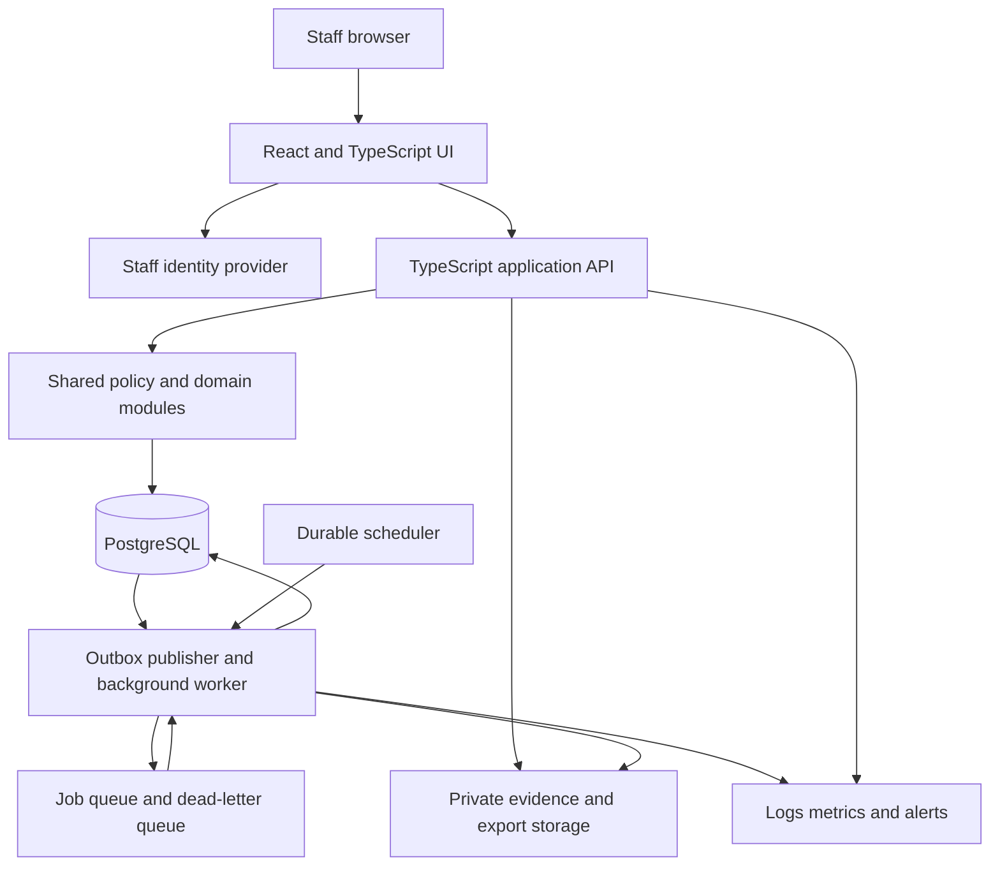

# Support Desk V6 — High-Level Design

Version 1.0 · 31 October 2026 · Reviewable production design

## 1. Purpose and source authority

Recreate the reviewed Support Desk application as a persistent, authenticated, multi-user support portal. Preserve its shared workspace, fast controlled intake and guided checks for consequential actions. Match the prototype's visual language while replacing simulation with dependable services.

This HLD and the [LLD](Support_Desk_LLD.md) use:

| Reference | Identity and use |
|---|---|
| DEV | `Support_Desk_V6_Development_Specification.pdf`, 100 pages; functional, production and acceptance requirements |
| VAL | `Support_Desk_Final_Validation_Report.pdf`, 12 pages; historical correction/regression evidence |
| AWS | `Support_Desk_V6_Proposed_AWS_Architecture.pdf`, 2 pages; candidate deployment topology |
| LIVE | Signed-in review at `https://cs-portal-guided-review.ramesh-s325387.chatgpt.site/`; captured screens and delivered source |
| USER | Current conversation decisions; these override conflicting older proposals |

Keep observed behavior, production requirements and design proposals separate. Where documents and live behavior disagree, record the conflict and ask the product owner; do not silently prefer either. Source hashes are in [the manifest](reference/source-manifest.json). Live source capture is a separate identity, not verified repository provenance.

## 2. Confirmed scope and exclusions

### 2.1 Confirmed decisions

| Topic | Confirmed direction |
|---|---|
| Target | Production application, with real identity, durable records and multi-user access |
| UI | Preserve layout, wording and styling; apply required accessibility and production corrections |
| Technology | React/TypeScript frontend; TypeScript modular API and worker; PostgreSQL |
| Launch | Manual customer communications, order verification, shipments and payment-result evidence |
| Approval | One eligible manager decision; **self-approval is allowed**, including materially edited requests, subject to ordinary authority/scope/state checks |
| Test deadlines | Retain demo elapsed-hour defaults for testing; production SLA targets remain unapproved |
| Deployment | AWS remains a candidate; no cloud provisioning or cost commitment is approved |

### 2.2 Functional scope

Deliver one shared customer directory across brands, shared ticket/history visibility, controlled intake, ticket collaboration, revisioned service approvals, returns/inspection/waivers, replacements/cancellation, refund authorisation/reconciliation, dispute tracking, follow-ups/reminders, Insights, eight export datasets and administration/master data.

Real migration preview/publishing is required, but source-specific mappings and cutover need actual legacy data. Keep duplicate review and keep-separate decisions. Irreversible customer merge is a separately gated future operation.

Actual email ingestion/sending, Shopify/order verification, carrier booking/tracking, WMS feeds and payment initiation are later integrations. A saved portal record must never claim that one of these external actions occurred without independently recorded evidence. Identity-provider invitations/recovery are account-security operations and are distinct from customer communication integrations. Their provider and delivery policy remain open. (DEV pp.4, 11, 18–20, 94–98.)

## 3. Users, visibility and authority

| Role | Main responsibility | Important boundary |
|---|---|---|
| CS Executive | Lookup/intake, customer/ticket work, communications, follow-ups | No final service/refund/waiver approval from CS role alone; no default export |
| Country Manager | Service decisions within assigned country; CS work when granted | Global shared reads do not imply global decisions |
| Head of CS | Cross-market manager decisions and oversight | Logistics, finance and correction grants are not implied |
| Logistics | RMA, parcel matching, physical receipt, cancellation checks, replacement dispatch | Receipt is separate from carrier-delivered status and payment |
| Finance | External refund attempt outcomes and reconciliation; dispute work when granted | Finance grant does not confer manager approval authority |
| Data Steward | Protected corrections, import and duplicate review | No default ticket work or real merge execution |
| Super Admin | Full administration and operational controls | Cannot erase audit or bypass business invariants; last active administrator protected |

Grants are a union across roles. Reserved role identities `super`, `head`, `cm` confer manager authority under explicit scope checks; editable role names do not. There is no generic `approve` grant. Self-approval is allowed, but its requester/approver identity must remain visible in audit. Preserve separate account, action, market and stage eligibility checks. (DEV pp.5–8, 64–70; user decision.)

## 4. System architecture

Use a **modular monolith**: one application API, one independently deployed worker from the same domain code, one relational database and private object storage. This keeps approvals, receipt quantities, funds and closure within transactional boundaries. Do not start with independently deployed domain microservices.

Diagram arrows show dependencies and work flow; all traffic uses authenticated/authorised boundaries. Object storage is not public. External customer/commerce/payment adapters are deliberately absent from the launch execution path.

### 4.1 Components

| Component | Responsibility | Boundary |
|---|---|---|
| Web UI | Shared shell, navigation, forms, drafts, guided confirmations, reports | No authoritative balance or permission decisions in browser |
| API | Identity validation, authorised projections, queries, commands, transactions | Never trust client actor/role, approval status or computed balances |
| Domain modules | Policy, workflow validation, balance and closure evaluation | Shared by API and worker, not copied into each route |
| PostgreSQL | Transactional records, immutable revisions/events, task state, outbox, idempotency | Source of truth for workflow decisions |
| Worker | Due scans, reminders, escalation, exports, malware-scan coordination, import processing | Durable retries; no autonomous payment initiation or business approval |
| Object storage | Quarantined evidence, approved files, generated exports | Metadata and access checks in API; short-lived access, never public URLs |
| Identity provider | Staff login and identity lifecycle | Business roles/scope remain server-owned |

Choose Fastify for the proposed TypeScript HTTP layer, SQL migrations with the PostgreSQL driver, and shared schema validation. These are DESIGN defaults, not claims about the prototype. Pin supported dependency versions during implementation. Avoid introducing a search engine, Redis, reporting warehouse or event-sourcing platform until measured need justifies one.

### 4.2 Domain decomposition

| Module | Owns | Key dependencies |
|---|---|---|
| Access | Users, roles, grants, scopes, eligible-owner evaluation | Every command; user/role change impact analysis |
| Customer identity | Shared customers, contacts/aliases, identity review and corrections | Ticket intake, search, migration |
| Catalogue | Brands, type semantics, category tree, products, countries/warehouses, reference lists | Intake, scope, service lines |
| Ticketing | Ticket context, classification, claims, timeline, resolution episodes | Customers, tasks and all closure obligations |
| Service | Return/replacement/cancellation requests, revisions, approvals | Verified order context, catalogue, task routing |
| Returns | RMA, physical receipt ledger, inspection, collection waivers, parcels | Service scope, Logistics and manager authority |
| Fulfilment | Replacement shipment/delivery and cancellation/fallback evidence | Approved scope, returns and refund treatment |
| Finance | Authorisations, amount amendments, attempts, reserved/paid balance | Verified order identity, service revision and evidence |
| Disputes | Provider deadlines, evidence versions, submission/outcome | Dispute grant, tasks and closure |
| Tasks | Independent obligations, ownership, deadlines, reminders and miss history | Source-specific domain transitions |
| Reporting/data transfer | Canonical filters, metrics, exports, staged imports | Authorised projections, source provenance |

## 5. UI/UX architecture

Preserve the sidebar groups WORK / REPORTS / SETTINGS, top global search, current identity/role/scope, reminder entry and card/table layout. Replace the demo role selector with actual identity. Remove reset-demo controls from production; keep sample journeys in a synthetic training environment only.

Navigation comprises My work, Customers, New Query, All Tickets, Ticket Requests, Follow-ups, Logistics, Insights, Exports, Master data, Category Management, Product Management, User Management, User Profile Requests and Profile & Security. Category/Product shortcuts reference the same master entities. Full subviews and field behavior are in LLD §3.

Preserve distinctions in language and styling: Assigned to / Working now / task owner; lifecycle status / approval state / shipment state / payment outcome; expected / physically received / waived / still due. Show exact revision/item/quantity/amount at consequential confirmations. A copied reply is never a sent reply.

Long controlled lists become searchable, keyboard-operable selectors. Filters never create new master values. Required production UI states include loading, empty, forbidden, failed save, disconnected claim, stale version and recoverable draft. Preserve identity/role/scope on narrow layouts; tables have deliberate horizontal scrolling. Evaluate 350px, 390px, tablet and desktop widths and WCAG 2.2 AA criteria; this document is not an accessibility certification. (DEV pp.4–5, 21–30; VAL UI-01.)

## 6. Data and consistency architecture

Use immutable IDs and separate display references. Link customers across brands; represent order identity with source namespace + brand + external order reference. Record explicit manual verification rather than treating customer history as order ownership proof. Preserve historical label/actor snapshots alongside current IDs.

Approved service scope, receipts, waiver decisions, payment evidence, audit and resolution history are immutable records. Current operational state is derived from those records and validated projections. This is a transactional relational application with append-only histories, not full event sourcing.

Every accepted business command commits domain changes, audit, applicable tasks and outbox records in one transaction. Rejected validation changes none of those business records; sensitive denials may be recorded separately as security events. Use optimistic versions plus aggregate locking where quantities, funds or cross-record gates are at risk.

An outbox makes database-to-queue handoff recoverable; consumers deduplicate because delivery may repeat. This follows the [AWS transactional outbox guidance](https://docs.aws.amazon.com/prescriptive-guidance/latest/cloud-design-patterns/transactional-outbox.html). The worker never uses a reporting projection as approval or closure authority.

### 6.1 Invariants that must hold

1. Shared contact details may belong to different people; no automatic merge or phone-suffix identity selection.
2. Only the exact current approved revision permits execution; master renames do not rewrite approval snapshots.
3. Waiver approval changes collection obligation, never physical receipt or refund authority.
4. Advance replacement keeps inbound and outbound obligations independent.
5. Pending/unknown refund attempts reserve authority; final failed/succeeded attempts cannot be overwritten.
6. Reassignment, rescheduling or snooze cannot erase first-miss attribution.
7. Resolve and Close re-evaluate every current domain obligation and open task, not a browser status flag.
8. Access changes cannot strand open work or remove the final active Super Admin.

## 7. Main operating flows

### Intake to ordinary resolution

Lookup exact contact → choose person if ambiguous → inspect history → select controlled issue details → create ticket and owned task → claim work → record actual updates/follow-ups → resolve when all gates pass → reviewed closure. Unclassified intake creates eligible-manager classification work; generic completion cannot bypass it.

### Service to fulfilment

CS submits verified order/item scope → manager reviews exact revision and decides → Logistics records real external execution → CS confirms exact remedy and customer notices → closure gates recheck returns, inspections, finance, disputes and tasks. Need information cycles do not create a scope revision. Material scope changes do and require a fresh decision.

### Refund to reconciliation

CS/Finance requests exact authorisation → eligible manager decides → Finance records an external attempt → unknown/pending amount remains reserved → reconcile to immutable success/failure → retry a failed amount only as a distinct attempt → CS records customer notice. Portal actions record evidence; they do not send funds.

### Late arrival/reopening

Explicit authorised reopen → preserve previous resolution and all prior approvals → record late physical receipt/inspection → reduce effective waiver balance without rewriting its original decision → complete reopened work → re-evaluate resolution and closure.

## 8. Security, files and operations

Use invite-only staff identity and server-owned permissions. Provider choice, MFA/session/recovery settings remain decisions; recommend MFA for privileged and finance users. Validate tokens rather than merely decoding them; the [Cognito verification guide](https://docs.aws.amazon.com/cognito/latest/developerguide/amazon-cognito-user-pools-using-tokens-verifying-a-jwt.html) describes the checks if Cognito is selected. Current account/grant state is checked after identity validation, so a still-valid token does not preserve removed business access.

Use authorised search projections and explicit field whitelists. Enforce export generation and download separately. Exclude credentials, tokens and unnecessary customer/payment content from logs. Ordinary application roles, including Super Admin, cannot modify audit history.

Uploads pass size/type/checksum checks, quarantine and malware scanning before being usable as evidence. Download requests check current permissions. Record export query/snapshot/schema/checksum/row count, expiry and download audit. Retention periods, jurisdictional rules and file limits remain explicit decisions.

Observe request latency/errors, lock conflicts, stale commands, outbox age, job lag, DLQ count, overdue work, stranded-task eligibility, failed exports/scans and failed identity operations. Keep business audit distinct from infrastructure audit. Rehearse database restoration, object recovery, worker replay and release rollback.

## 9. Deployment proposal and service targets

The logical design can run on another approved platform without changing business semantics. If AWS is selected, map the components as follows; region, sizing and spend remain open.

| Logical component | Proposed AWS service |
|---|---|
| HTTPS entry / static frontend | Route 53, ACM, CloudFront + WAF, private S3 UI bucket |
| API / worker | ALB to ECS Fargate API; separately scalable Fargate worker |
| Transactional store | Private RDS PostgreSQL; Multi-AZ subject to agreed availability target |
| Identity | Cognito or federated organisational identity |
| Jobs / scheduling | SQS + DLQ, EventBridge Scheduler |
| Evidence / exports | Separate private S3 storage, KMS, quarantine/scan path |
| Operations | IAM task roles, Secrets Manager, CloudWatch, CloudTrail, ECR and infrastructure as code |

API/worker/database use private subnets. Public entry is restricted to HTTPS; constrain origin access and validate CloudFront-to-origin traffic. Do not cache authenticated API responses in a shared CDN cache. Separate development, staging and production accounts/resources and secrets. (AWS pp.1–2.)

Proposed, unratified targets from DEV p.10: p95 normal save/search ≤2 seconds; initial usable view ≤3 seconds; due-work processing ≤60 seconds after transition. Validate against agreed users, records, files and event rates. Uptime, RPO/RTO, retention, load envelope and monthly budget are **OPEN**, not promises.

## 10. Delivery and acceptance

| Stage | Deliverable | Exit evidence |
|---|---|---|
| 1 | Identity/access, shared catalogue/customer data, intake, tickets, search, audit | Multi-role direct-API checks, draft/identity/classification and concurrent-edit tests |
| 2 | Complete approval-to-closure service/returns/waivers/fulfilment/finance/dispute paths and durable tasks | End-to-end operational cases, race tests, no bypass/overpayment/history loss |
| 3 | Insights, eight stable exports, actual import preview/publish, administration hardening | Metric boundary/reconciliation tests, parsed downloads, migration replay/stale conflict tests |
| 4 | Migration rehearsal, usability/security/recovery/load verification | Signed UAT, restore/replay evidence, accessibility review and release rollback exercise |

Adapt the supplied acceptance criteria and 17 corrected-issue regressions; do not claim the historical test counts certify the new implementation. Explicitly test direct API denial, stale/revoked roles, wrong market, concurrent receipt/waiver, refund attempts, scope revision/dispatch, closure/new obligation and last-admin removal. Business owners sign off CS intake/closure, Logistics physical controls, Finance balances and technical operations separately.

The [decision register](Decisions.md) lists release gates. There is no approved silent fallback for an unresolved monetary, SLA, privacy or identity policy. Safe unrelated modules can proceed while affected actions remain gated.
