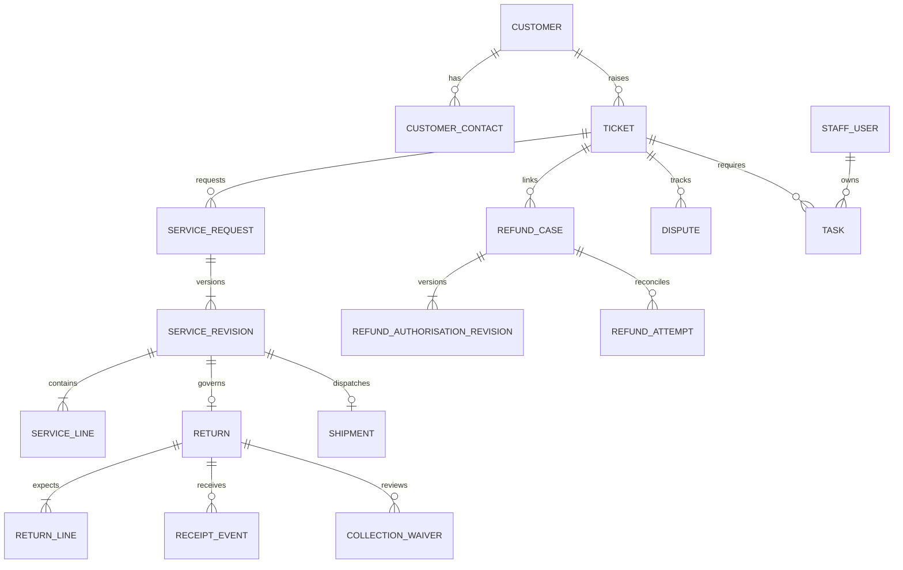
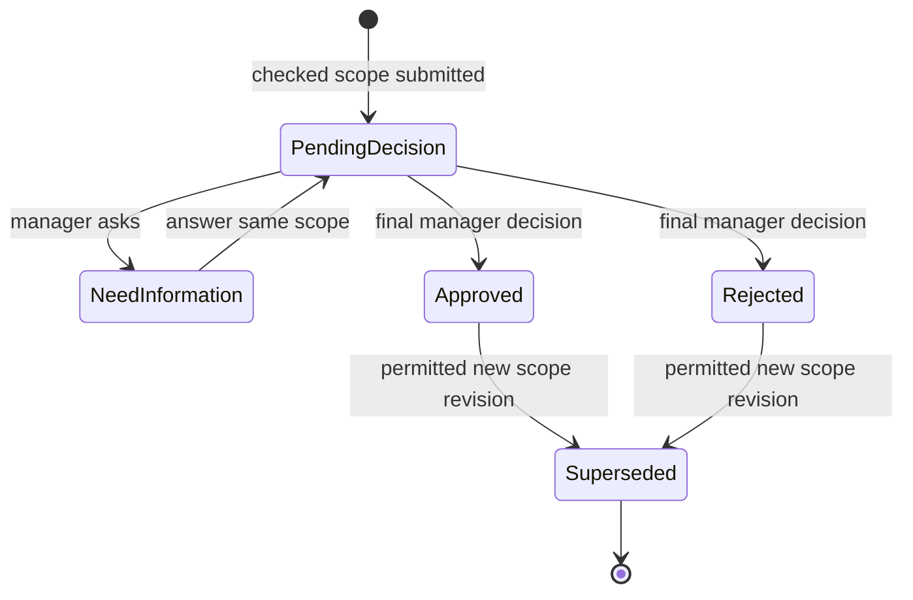
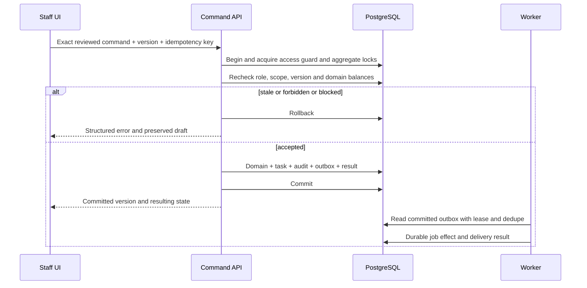

# Support Desk V6 — Low-Level Design

Version 1.0 · 31 October 2026 · Proposed implementation contract

## 1. Contract status and conventions

Read alongside the [HLD](Support_Desk_HLD.md), [decision register](Decisions.md) and supplied 100-page Development Specification. **DEV p.N** references that PDF. Table names, routes, schemas, lease settings and deployment mechanisms below are DESIGN proposals, not existing production code. BASELINE rules are attributed to DEV and the captured `reference/prototype-source/` files. Navigation-level screens were observed; not every modal/role/workflow was exercised in this session.

Confirmed stack: React/TypeScript UI; TypeScript API and worker; PostgreSQL. Proposed HTTP framework: Fastify. Use SQL migrations and parameterised PostgreSQL queries; shared runtime validation schemas generate API types. Select exact maintained dependency versions at build time. There is one deployable API and one worker, not one process per business module.

Use UUID internal IDs, separate human references, `timestamptz` UTC instants, explicit `Asia/Kolkata` display/calendar boundaries and integer currency minor units. A record's `version` increments on accepted aggregate mutations. Server generates actors, recorded times, role snapshots and correlation IDs. Unknown imported actor/time remains null with provenance, not the importing user's invented historical identity.

## 2. Application structure and service boundaries

```text
apps/web         React pages, shared shell, forms, accessible controls, query client
apps/api         HTTP routes, identity adapter, request schemas, transaction entrypoints
apps/worker      outbox publisher, due scans, imports, exports, scanning coordination
packages/domain  access, customers, catalogue, tickets, service, returns, fulfilment,
                 finance, disputes, tasks, reporting; pure rules + command handlers
packages/contracts shared enums, runtime schemas, generated DTO/API types
db/migrations    reviewed, versioned SQL schema changes
tests            policy, transaction, API, workflow, UI and recovery verification
```

This is a proposed layout for a new repository; it does not imply these application files already exist. Domain handlers receive an authenticated `ActorContext`, a transaction and typed command. Repositories perform parameterised SQL. Pages cannot directly set approval/payment/receipt states. Reporting uses a separate read layer over the same database initially.

| Interface | Inputs | Output / responsibility |
|---|---|---|
| `AccessPolicy.canRead/canAct` | Actor ID, current account/roles/scopes, action, record | Allow/deny and safe reason; shared reads distinct from scoped writes |
| `OwnerEligibility.forStage` | Source type, stage, record scope, candidate | Identical checks in pickers, assignment and access-change impact |
| `ScopePolicy.approver` | Reserved role IDs, active/read state, ticket country | Super/Head globally; CM exact country/All markets; self-approval allowed |
| `ScopeFingerprint.build` | Immutable revision/lines/arrangement/order/evidence snapshot | Versioned canonical representation + hash, not client hash authority |
| `TaskCoordinator.transition` | Source ID/revision, old/new stage, owner/due | Complete/cancel only applicable tasks; create next independent tasks |
| `ReturnBalance.calculate` | Expected lines, receipt ledger, applicable approvals | Expected, physical, effective waived, remaining per line |
| `RefundBalance.calculate` | Approved authority and attempt ledger | Authorised, paid, reserved, available in minor units |
| `ClosurePolicy.evaluate` | Current locked ticket and all obligations | Structured blockers plus domain-version references |
| `QueryPolicy.compile` | Validated filters, actor projection, report definition | Canonical query reused by count/list/export |

## 3. Frontend and UI/UX contract

### 3.1 Shared shell and design system

OBSERVED/CODE: desktop sidebar 226px, top bar 78px before responsive wrapping, main content max-width 1720px and padding 28px 30px 42px. Body DM Sans 16px, headings Manrope weight 800, h1 1.75rem, h2 1.2rem. Buttons typically 7px radius; inputs 6px radius/minimum height 43px; textareas minimum 100px. Read the captured CSS as the detailed visual reference rather than flattening its cascade into guessed constants.

| Token | Captured value | Use |
|---|---|---|
| ink / navy | `#18354b` / `#17364b` | Body text / navigation |
| teal / dark teal | `#007e83` / `#006269` | Primary action / hover |
| muted / border | `#63798b` / `#dce6ec` | Secondary text / dividers |
| background / pale | `#f2f6f8` / `#e5f4ef` | Page / informational panel |
| amber / red | `#fff2d7` / `#af493e` | Pending-warning fill / error text |
| shadow | `0 16px 48px #19364b12` | Raised surfaces |

Use CSS variables and shared `AppShell`, `PageHeader`, `Card`, `StatCard`, `StatusBadge`, `FilterBar`, `DataTable`, `SearchSelect`, `Dialog`, `EvidencePicker`, `Timeline`, `ScopeSummary` and `ErrorSummary`. Preserve badge text; color is supplementary. Do not classify statuses in production by regex matching their display labels; map stable state codes to presentation.

Captured stylesheet has overlapping breakpoints at 1600/1300/1200/1100/980/700/650px; preserve resulting behavior while consolidating CSS only after visual comparison. Five dashboard cards become three then two columns. Ticket detail moves from three columns to two to one. Narrow screens retain readable identity, effective roles and scope, a mobile navigation control and scrollable tables. Confirm 350/390px behavior; a screenshot at desktop width alone does not establish mobile parity.

Production removes the demo identity selector, reset-demo control and misleading tab-only reminder text. Current-user identity replaces the selector. Keep equivalent sample journeys in a synthetic training build. Load fonts from an approved bundled/licensed asset path or fallback; availability of the prototype's Google Fonts request is not a production dependency guarantee.

### 3.2 Screen and component register

All routes below are proposed browser routes. Reference filenames use the prototype navigation IDs.

| ID / route | UI and states to preserve | Main actions / source |
|---|---|---|
| UI-01 `/work` | Five count cards: Open team tickets, My next actions, Overdue follow-ups, Pending decisions, Rejected—action needed; team/mine views; first 6 tickets and first 4 owned actions | Cards open exact filtered full sets; new query; full follow-ups. `dashboard.png`; DEV pp.14–15 |
| UI-02 `/customers` | Searchable shared customer table; contact/alias context, country, history access | Add customer, select person, import preview, duplicate review where granted. `customers.png`; DEV pp.15–20 |
| UI-03 `/customers/:id` | Contact facts, retained aliases, historical non-test tickets across brands/statuses | New issue, protected email correction, review/resume intake. Source `customerPage`; DEV pp.16–20 |
| UI-04 `/queries/new` | Step 1 Check customer; step 2 Select issue details; found/ambiguous/no-match states; history warning and recent 4 tickets | Lookup, add-and-continue, review history, save/open or save/another. `new.png`; DEV pp.20–23 |
| UI-05 `/tickets` | Search + status/owner/category/type/brand/country/created filters; 10 rows/page; ticket/customer, subject/category, owner/worker, state/next action | Open ticket, export complete matching set; filters reset page 1. `tickets.png`; DEV pp.23–31 |
| UI-06 `/tickets/:id` | Conversation/activity, original customer words, update form, context, linked decisions and open obligations; version/worker/owner visible | Claim/release/takeover, assignment, update, classification, status, service, follow-up, correction, copy contacts/status. DEV pp.23–26, 57–63 |
| UI-07 `/requests` | Tabs Service approvals / Return waivers / Protected corrections; queue search; request revision, decision and next owner | Review → Decision → Confirm; need-info/answer/revision/correction flows. `requests.png`; DEV pp.18–20, 40–49 |
| UI-08 `/follow-ups` | Open / Mine / Overdue / Decisions / Rejected / History; owner/source/text filters; 10 rows/page | Source navigation, detail, eligible handover, deadline change, snooze, exact-stage completion, matching export. `tasks.png`; DEV pp.26–29 |
| UI-09 `/logistics` | Returns / Return waivers / Replacements / Refunds / Disputes; unmatched badge and parcel list | RMA register, tracking, receipt/inspection, waiver, shipment, cancellation checks, refund request/reconcile, dispute evidence. `logistics.png`; DEV pp.42–57 |
| UI-10 `/insights` | Voice of the Customer; brand/country/date filters, independent 7/30/60 complaint panels, comparison cards, resolution/friction and missed-follow-up analysis | Full-path complaint drilldown, ticket/task cohorts and export. `insights.png`; DEV pp.31–34, 85–90 |
| UI-11 `/exports` | Eight dataset choices, shared search, preview, copy/download and durable job/history states | Exact filtered export, schema/as-of/row-count evidence, authorised downloads. `exports.png`; DEV pp.34–39 |
| UI-12 `/masters/:kind` | Nine sections; categories/products dedicated forms; other reference tables; fixed status list | Search/add/edit/archive/restore as permitted; reference-only labels explicit. `masters.png`; DEV pp.73–84 |
| UI-13 `/masters/categories` | Main/child tree rows, type/path, use count, Active/Archived/Parent archived, subtree delete review | Main/child create/edit, archive/restore, unused subtree delete. `category-shortcut.png`; DEV pp.73–75 |
| UI-14 `/masters/products` | Name/SKU, brand/capacity, active state; history remains readable | Create/edit/archive/restore/delete unused. `product-shortcut.png`; DEV pp.75–77 |
| UI-15 `/admin/users` | Users / Roles & permissions / Admin activity; effective-grant preview and affected-work review | User invite/access, role membership, scope, state; role editor; handover. `users.png`; DEV pp.64–70 |
| UI-16 `/admin/profile-requests` | Recovery request identity/state/review; distinguish verification from actual delivery | Re-resolve current identity on save; actual provider recovery separately integrated. `resets.png`; DEV pp.71–73 |
| UI-17 `/profile` | Current name/email/roles/timezone/scope and effective permissions | Provider-backed recovery request; no simulated success. `profile.png`; DEV pp.71–73 |

UI-03 and UI-06 are nested views defined by source/PDF, not independent screenshots in this capture. The 15 navigation captures include both master shortcuts and their shared destination.

### 3.3 Forms and conditional behavior

| Form | Fields and validation | State/draft behavior |
|---|---|---|
| Customer lookup/create | Canonical email or complete international phone; explicit calling code for local input; customer name trimmed/nonblank; active country; at least one contact | One exact match can select; household ambiguity requires person choice; duplicate create requires documented distinct-person confirmation |
| Intake | Customer, brand, active channel, semantic query type, main category, child when active children exist, optional product/capacity/order/message, received time not future | Changing brand/type/parent clears incompatible children/product/capacity; product fixed capacity locks input; same-person history preserves draft; changing person clears issue draft |
| Ticket update | Kind: internal note / reply received / update actually sent / remedy confirmed; meaningful text; occurred time ≤now; optional exact task/request revision | Current claim or explicit start-and-save; takeover confirmation preserves text; copying never sends; stale version retains draft |
| Service | Return/Replacement/Cancellation; order verification evidence/assent; product lines 1–999 whole units, unique products; reason, eligible manager, future due; replacement path/outbound lines/exception reason | Review exact scope then decide then confirm; no-return needs explicit assent; material scope change creates new revision |
| Receipt/inspection | Cumulative per-line physical counts, occurred time, inspection result, proof, next owner/check | Nondecreasing counts ≤expected; no future/before-previous receipt; quantities never changed by carrier status; changed receipt invalidates pending waiver snapshot |
| Waiver | Existing RMA, selected outstanding quantities, reason/evidence, manager/due; decision note and explicit approval assent | At least one positive whole quantity ≤remaining; one undecided waiver; approved notice separate from collection settlement |
| Shipment/cancellation | Exact approved scope; unique shipment reference, proof, destination/SKU check; or stop/cancel outcomes, alternative Return/refund treatment | No overwrite of shipment; Already dispatched + Confirmed cancelled rejected; fallback does not rewrite original approval |
| Refund | Order verification, currency, nonnegative goods/shipping with positive sum, optional service revision, evidence, manager; attempt amount/reference/result/proof/owner/check | Separate proposed vs approved totals; no amendment while funds unresolved; immutable final outcomes; no auto-payment |
| Task | Controlled manual action, eligible owner, future due; change reason; actual completion/outcome/confirmation | Original due and first miss preserved; snooze only reminder; generic completion cannot complete classification/domain actions |
| Protected correction | Target field, original/proposed value, reason/evidence, base version | Normalise/recheck aliases and competing proposals; reject stale; keep customer ID and old alias |

Dialogs trap focus, expose accessible title/error summary, focus first invalid field on failure and restore triggering focus on close. Confirmation includes exact object/revision/quantities/currency and consequences. Network/validation failure retains form values. Clear drafts after confirmed commit/discard, not after a failed request. Drafts are user+customer+form scoped, server-persisted with version and explicit expiry policy; never share another user's draft or reuse it for another customer.

## 4. Relational data model

### 4.1 Common storage rules

Mutable roots: `id UUID PK`, `reference TEXT UNIQUE` where exposed, `version BIGINT CHECK >0`, `created_at`, `updated_at`, creator/editor FK. Event/revision records are insert-only under application DB roles. Use FKs with RESTRICT for referenced domain records; archive instead of cascading deletion. Store historical snapshots as validated JSONB, not arbitrary raw browser objects. Keep indexed relational keys for joins/invariants.

`occurred_at` describes actual work; `recorded_at` is server insertion. Snapshot fields include source identity, actor display/roles, selected labels and exact scope. Null unknown values carry `history_coverage` / `source_metadata`. Evidence references point to structured records/files; free text is escaped in UI, never interpreted as HTML.

### 4.2 Entity dictionary

| Table / aggregate | Required attributes beyond common fields | Relationships / constraints |
|---|---|---|
| `staff_users` | identity_provider, subject, normalised work_email, name, status, permission_version, legacy_scope_mode | Unique provider+subject and normalised staff email; Active/Invited/Inactive; no user deletion API |
| `roles`, `role_grants`, `user_roles` | Stable reserved role key, display name, builtin flag; one of 16 grant codes | Composite membership PKs; Super locked to all grants/name; CS retains read |
| `countries`, `warehouses`, `user_scope_memberships` | Country code/name/state; warehouse country/name/state; market/warehouse membership | Stable IDs; retain legacy All markets/All warehouses semantics until scope policy migration approved |
| `brands`, `query_types`, `categories` | Brand identity; type semantic_code/label/state; category type_id, parent_id, name, state | Categories max two levels, no cycles, same type; unique normalised sibling name among nondeleted; fallback classification is reserved |
| `products`, `product_brands`, `reference_values` | SKU/name/capacity ref/state; applicable brands; kind/code/label/state | Case-insensitive active/archived SKU uniqueness; Both brands represented by memberships; historical IDs never reused without approved policy |
| `customers` | Name, country_id, version | Shared across brands; not keyed by contact |
| `customer_contacts`, `identity_reviews` | Type, original, canonical, is_primary, is_historical; candidates, reason, reviewer/disposition/evidence | Shared contact values allowed; unique within person/type/canonical; one primary per contact type; no blanket global contact UNIQUE |
| `order_contexts`, `order_verifications` | Namespace, brand_id, external_reference, normalised_ref, customer_id; verifier, scope, evidence, occurred_at | Unique namespace+brand+normalised_ref; verify customer ownership/relevant order lines; no assumed order integration |
| `tickets` | Customer, brand, country, order nullable, type/category/product IDs + saved labels/SKU/capacity, channel, priority, subject, original_message, status, owner_id, received_at, resolution_due, current_resolved_at | Fixed lifecycle; snapshot vs current-contact semantics explicit; no direct rewrite of protected order link |
| `classification_events`, `resolution_episodes`, `ticket_updates` | Before/after classification/reason; cycle start/resolve/reopen; kind, text, occurred/recorded, actor, exact scope/task/assents | Append-only histories; original customer wording retained |
| `work_claims`, `user_drafts` | Ticket, worker_id, lease_id, expires_at, heartbeat; user/customer/form/base_version, payload | At most one current claim row/ticket; takeover compare-and-swap; unique user+customer+form draft key |
| `protected_corrections` | Customer/ticket target, field, old/proposed canonical, base_version, requester, reason, state, decision | One final decision; lock contact comparison namespace for competing corrections; preserve old aliases |
| `service_requests`, `service_revisions`, `service_lines` | Logical chain/current revision; kind, state, previous revision, scope hash, reason, arrangement, exception, evidence; direction/product/line ID/quantity/snapshots | One current revision/chain; lines unique per direction+product; quantity 1–999; immutable approved snapshot |
| `decisions`, `attestations` | Target kind/revision, decision, note, actor/roles/time, scope fingerprint; displayed assent text/version/accepted boolean | Unique final accepted decision per revision; need-info events nonfinal; self-approval recorded and allowed |
| `returns`, `return_lines` | RMA normalised ref, service revision, warehouse, hold, tracking, instruction state, receipt_version; service_line_id, expected | One RMA per applicable current chain with revision history; case-insensitive RMA unique; preserve stable received line mapping |
| `receipt_events`, `receipt_event_lines`, `inspection_events` | Return, delta/cumulative before-after, occurred/recorded, evidence; line quantities; condition/scope fingerprint | Append-only physical facts; serialized nonnegative delta ≤expected; inspect all physical quantities at current receipt version |
| `collection_waivers`, `waiver_lines`, `waiver_events` | Return+service revision, receipt version/scope snapshot, state, requester, reason/evidence, owner/due; proposed quantities; decisions/info/withdrawal/notice | One undecided waiver/return; original approved quantity immutable; effective balance calculated |
| `shipments`, `shipment_lines`, `remedy_confirmations` | Service revision, unique normalised shipment ref, proof, dispatch time, destination assent; approved lines; exact revision+scope+delivery/remedy evidence | One shipment/current approved scope; no partial/substitute shipment launch behavior; confirmation is separate fact |
| `cancellation_executions` | Revision, stop/cancel outcome, alternative_return_revision, refund treatment, proof, actor/time | Append evidence updates; alternative same ticket/full item coverage; no destructive overwrite |
| `parcels`, `parcel_matches` | Warehouse, external ref, evidence, status, owner/due; return link, identity evidence, time | One current match/parcel; matching creates no receipt; uniqueness namespace remains policy-gated |
| `refund_cases`, `refund_authorisation_revisions` | Ticket/customer/brand/order context, currency; requested/approved goods/shipping minor, scope hash, state, previous authority, reason/evidence | Unique live nonrejected authority per approved order namespace; current approved revision separate from pending amendment |
| `refund_attempts`, `refund_attempt_events` | Refund, authority revision, reference normalized, amount_minor, result, proof, Finance owner, due, history_coverage | Positive amount; globally case-insensitive ref unique initially; at most one unresolved/refund; success/failure final |
| `disputes`, `dispute_evidence_versions`, `dispute_events` | Ticket/provider ref, provider_deadline, state, submitted_at; evidence hashes/receipt; actual outcomes | Provider deadline independent of internal due; no downgrade/terminal overwrite; expanded result taxonomy gated |
| `tasks`, `task_events`, `notifications` | Source kind/ID/revision, step, ticket nullable, owner, original/current due, remind_at, status, first_miss/owner, completed/cancelled times, coverage | Partial unique source+revision+step WHERE open; explicit source FK fields/checks; exact-stage completion; notification dedupe |
| `evidence`, `evidence_links`, `file_objects` | Structured reference/text, actor, time; domain target; object key, hash, type, size, scan state | Allow structured evidence without file; only clean files usable/downloadable; linked access checked |
| `audit_events`, `security_events` | Actor, roles, action, target/revision, occurred/recorded, reason, safe before/after, correlation | Business audit transactional/append-only; sensitive denial log separate; no secrets |
| `outbox_events`, `job_inbox`, `idempotency_records` | Event kind/aggregate/version/payload/publish lease; event+consumer status; actor+operation+key/hash/result | Durable dedupe and recovery; unique keys; no idempotency success before business commit |
| `import_batches`, `import_rows`, `source_mappings` | Source file checksum/schema, reviewer, state; source ID/version/disposition/errors; source→target map | Unique source_system+record_type+source_record_id; row-level stale protection and publish outcome |
| `export_jobs`, `export_download_events` | Dataset/schema/filters/as_of/query hash/actor/projection, job status, row count/object/checksum/expiry | Recheck generation/download; durable repeatable snapshot; no public file key exposure |
| `identity_requests` | Type, account/email identity, review_version, status, provider operation ID, outcome history | Invitation/recovery state distinct from actual provider delivery; duplicate/rate-limit policy required |

Tasks use explicit nullable FK columns for supported source aggregates plus a CHECK enforcing exactly one matching source, rather than an unchecked polymorphic ID that can orphan obligations. `ticket_id` may be null only for supported standalone parcel work. Audit/event target IDs can remain typed references because target deletion is restricted and event retention is independent.

### 4.3 Important indexes and constraints

- Contacts: `(kind, canonical_value)` for lookup plus customer join; optional trigram index on whitelisted discovery text when performance warrants it. Shared contact duplicates remain legal.
- Tickets: `(created_at DESC,id DESC)`; `(status,created_at,id)`; `(owner_id,status,id)`; `(customer_id,created_at,id)`; brand/country/date combinations selected from measured queries.
- Tasks: `(owner_id,due_at,id) WHERE status='open'`; `(due_at,id) WHERE open`; first-miss/date and source-stage partial unique indexes. Distinct manual tasks get distinct source instance IDs so the constraint does not prohibit legitimate parallel follow-ups.
- Outbox/jobs: `(next_attempt_at,id) WHERE unpublished`; lease expiry; inbox unique `(consumer,event_id)`; notification unique `(task_id,schedule_generation,threshold,recipient_id,channel)`.
- Money: `BIGINT CHECK amount>=0`, bounded to validated safe range; currency definition supplies exponent. Avoid floating arithmetic. Currency/order changes require separately approved relinking policy.
- Aggregate versions, unique final decisions, case-insensitive RMA/shipment/attempt references and service-line keys are database-backed, not UI-only checks.
- Contact correction submission/approval acquires a transaction-scoped lock on the canonical proposed identity and checks primary/aliases and pending proposals under that lock; no global contact unique constraint is introduced.

### 4.4 Entity relationship overview



Diagram omits audit, evidence, catalogue, nullable standalone parcel tasks and some revision links for readability; the dictionary is authoritative for proposed storage relationships.

## 5. Identity, grants, scope and administration

### 5.1 Exact grant catalogue and defaults

| Grant | Super | CS | CM | Head | Logistics | Finance | Steward |
|---|---|---|---|---|---|---|---|
| read | Y | Y | Y | Y | Y | Y | Y |
| work | Y | Y | Y | Y | — | — | — |
| assign | Y | Y | Y | Y | — | — | — |
| correction | Y | — | — | — | — | — | Y |
| merge | Y | — | — | — | — | — | Y |
| importPreview | Y | — | — | — | — | — | Y |
| importPublish | Y | — | — | — | — | — | Y |
| logistics | Y | — | — | — | Y | — | — |
| finance | Y | — | — | — | — | Y | — |
| dispute | Y | — | — | — | — | Y | — |
| insights | Y | Y | Y | Y | Y | Y | — |
| export | Y | — | Y | Y | — | Y | — |
| masters | Y | — | — | — | — | — | — |
| accounts | Y | — | — | — | — | — | — |
| users | Y | — | — | — | — | — | — |
| roles | Y | — | — | — | — | — | — |

These are baseline role compositions, not a production staff roster. Multiple roles union grants. A `cm`/`head`/`super` identity must also be Active and have read for server decision commands. Classification additionally requires work. A custom role with every grant still has no reserved manager authority. Protected corrections use `correction`, not manager title. `assign` is needed with work for explicit reopen.

Preserve current All warehouses as a global operational wildcard, including Finance, until a separately approved scope migration; it does not give `cm` a global manager-approval wildcard. Ordinary read remains shared across countries/brands. Normalize market/warehouse IDs in storage but retain a versioned legacy scope mode so changing strings to IDs does not silently change authority. General CS mutation-scope policy beyond documented action checks remains OPEN.

### 5.2 Stage ownership

| Source/stage | Owner requirement after Active/read/scope |
|---|---|
| Service/waiver/refund decision | Eligible reserved manager |
| Classification | Eligible reserved manager + work |
| Waiver information | work OR logistics |
| Customer update, rejection explanation, remedy, cancellation alternative | work |
| Refund information | work |
| Refund attempt/reconciliation | finance |
| Dispute evidence/provider outcome | dispute, without an extra finance requirement |
| Return/parcel/fulfilment | logistics |
| Ordinary ticket review | work |

Assignment and current worker are independent of task ownership. Do not automatically hand over all tasks when changing ticket owner.

### 5.3 Administration transactions

Preview affected open tasks/ticket assignment/worker claims before user or shared-role access changes. At commit, take an exclusive `FOR UPDATE` lock on a singleton `access_policy_guard` row, then lock impacted users and work assignments. Ordinary protected commands, assignment and create-work take `FOR SHARE` on the same guard before domain aggregates; they can run concurrently with each other but cannot race a policy change. Recompute current→proposed eligibility, preserve equivalent grants through other roles, reject stranded work and protect last Active Super Admin. Block both Active→Inactive and Active→Invited where needed. Handover preserves due dates, first-miss owner and history. Record role/user before-after and invalidate permissions/session access promptly.

Use one guard at launch for simple correctness; narrow its locking only after concurrency measurements. Exclusive permission edits serialize against protected work; shared ordinary work remains concurrent. Do not upgrade a shared lock midway through a command: choose exclusive mode up front for access edits. Approval confirmation rechecks current policy inside its transaction.

Delegate Super Admin assignment or privilege expansion only after D-06 approval; the prototype permits broad delegation but production boundaries are unapproved. Keep Super's all-grant identity and CS's read protection. Fixed lifecycle masters are immutable even for Super Admin. No delete-user/role API is required at launch.

## 6. Command/API design

### 6.1 Transport and common envelope

DESIGN base `/api/v1`, JSON over HTTPS, same-origin browser deployment where possible. Identity tokens authenticate against the selected provider; the API resolves current user/roles/scope. Do not accept actor ID, role list, approver authority or recorded time from clients. Authorization header tokens remain in runtime memory, not URLs, logs or persisted drafts. Use the provider's established login/refresh flow; provider/session parameters remain gated by identity policy.

For create/action commands require `Idempotency-Key` and request body `{type, expectedVersion, payload}`; `expectedVersion` is omitted only when no existing aggregate is mutated. The authenticated user, HTTP method and canonical path scope the idempotency namespace. Use a different key for an intentionally new command. The same key+same canonical body returns original committed result; changed body is 409. Retention is a launch decision. No endpoint accepts raw computed balances as authority.

```json
{
  "type": "RecordRefundAttempt",
  "expectedVersion": 7,
  "payload": {
    "authorisationRevisionId": "<uuid>",
    "amountMinor": 7200,
    "reference": "EXT-REF-104",
    "result": "Outcome unknown",
    "evidenceIds": ["<uuid>"],
    "evidenceNote": "Provider result awaiting verification",
    "ownerId": "<uuid>",
    "nextCheckAt": "2026-11-02T10:00:00+05:30"
  }
}
```

Accepted result: `data` contains aggregate ID, committed version, state, canonical balance where relevant and affected task IDs; `meta` contains correlationId/serverTime. Use 201 for created roots, 200 for committed actions, 202 for queued jobs. Asynchronous identity delivery never returns an invented Sent status.

Errors use `{error:{code,message,fieldErrors:[{path,message}],blockers:[{code,recordType,recordId,message}],currentVersion,retryable,correlationId}}`. Only return authorised blocker context. 400 malformed/unknown field or enum; 401 absent/invalid identity; 403 missing grant/scope; 404 non-visible/missing resource; 409 stale state/version/idempotency conflict; 422 valid shape but failed business rule; 429 rate limit; 503 dependency unavailable. Stale forms keep the draft and show refresh/re-review; no automatic resubmission of a changed approval or financial command.

### 6.2 Query catalogue

| Method and route | Query / projection |
|---|---|
| GET `/me` | Identity, effective grants, approval authority summary, scope, policy version |
| GET `/work` | Counts/previews with common asOf and predicate tokens |
| GET `/search` | q≥2 chars; up to 6 customers + 6 non-test tickets, authorised field projection |
| GET `/customer-lookup` | kind=email/phone, value, explicit callingCode when needed; exact identity candidates, never partial-autoselect |
| GET `/customers`, `/customers/{id}` | Paginated shared directory/detail with contacts and identity-review context |
| GET `/customers/{id}/tickets` | Full shared history with stable pagination |
| GET `/tickets`, `/tickets/{id}`, `/tickets/{id}/activity` | Canonical filters; root/version/claim, timeline, obligations, snapshots |
| GET `/tickets/{id}/closure-check` | Current blocker assessment for display; mutation must recheck |
| GET `/service-requests`, `/service-requests/{id}` | Current/all revision filter, scope, decisions, ancestor history |
| GET `/returns`, `/returns/{id}`, `/waivers`, `/waivers/{id}` | Physical/waived/due and snapshot/notice history |
| GET `/shipments`, `/parcels`, `/refunds`, `/refunds/{id}`, `/disputes`, `/disputes/{id}` | Scoped actions with shared readable context and explicit external-evidence status |
| GET `/tasks`, `/tasks/{id}`, `/reminders` | Queue/owner/source/text; independent personal and manager attention |
| GET `/eligible-owners` | targetType, targetId, stage; versioned eligibility, rechecked on commit |
| GET `/masters/{kind}` | Active choices or authorised administration projection; category parent/type/brand query |
| GET `/admin/users`, `/admin/roles`, `/admin/activity`, `/identity-requests` | Grant-protected administration views |
| GET `/insights` | Selected/current and previous cohorts plus independent complete-day rankings |
| GET `/exports`, `/exports/{id}`, `/imports/{id}` | Job metadata, filters, schema, errors/row dispositions; no raw secret object URLs |
| GET `/drafts/{key}` | Only authenticated owner's matching customer/form draft |

List defaults: page 1, pageSize 10 for ticket/task parity; other lists default 25, maximum 100. Return items,total,page,pageSize,asOf,sort. Stable ordering includes ID tie-breaker; use dueAt,id for task queues and createdAt DESC,id DESC for tickets unless a view explicitly overrides it. Date inputs are ISO calendar dates; canonical server conversion is `[start-of-first-day, start-of-day-after-last)` in specified timezone. Filters run before pagination. Use canonical query tokens for report drilldowns. Interactive lists reflect current state at request time; exact reproducible export snapshots are defined in §10, not implied by merely sending an asOf timestamp.

Search uses whitelisted projections/joins, not raw-object JSON scans. Email trim/lowercase/leading-mailto removal; phone discovery accepts formatted queries with ≥5 digits against actual phone fields only. Exact identity resolution requires the whole canonical number or exact stored full digits; never infer country from a suffix. Supported ticket filters: q,status,ownerId,categoryId,typeCode,brandId,countryId,createdFrom,createdTo,timezone,excludeTest. Task filters add queue,sourceType,stage,ownerId and first-miss range. Linked customer/contact/alias/order/RMA/tracking search must work on operational and export datasets.

### 6.3 Mutation catalogue and payload contracts

Each command below has its own schema/discriminator. A route family's `/commands` endpoint dispatches to explicit handlers; there is no unrestricted generic field patch. Consequential fields not listed are rejected. Evidence can be structured evidence IDs and/or a meaningful evidence note as permitted by domain validation. All foreign IDs and conditional ownership/due selections are revalidated.

| Route | Type | Payload beyond common envelope |
|---|---|---|
| POST `/customers` | CreateCustomer | name, countryId, email?, phone?, distinctPersonReview?{candidateIds, reason, evidenceIds} |
| POST `/tickets` | CreateTicket | customerId, brandId, countryId, channelId, typeId, categoryId, productId?, capacityId?, orderContext?, receivedAt, originalMessage?, initialOwnerId, classificationOwnerId? |
| POST `/tickets/{id}/commands` | ClaimWork / RenewClaim / ReleaseClaim / TakeOverWork | leaseId where existing; takeover reason and expected claim identity |
| same | AssignTicket | ownerId, reason |
| same | RecordUpdate | kind, text, occurredAt, leaseId, actualActionConfirmed?, taskId?, requestRevisionId?, refundTreatment?, evidenceIds? |
| same | ClassifyTicket | typeId, mainCategoryId, childCategoryId?, productId?, reason |
| same | ChangeStatus / ReopenTicket | targetStatus, reason, closureAssent?; reopen requires assign+work |
| POST `/protected-corrections` | RequestCorrection | targetType, targetId, field, baseVersion, proposedValue, reason, evidenceIds? |
| POST `/protected-corrections/{id}/commands` | DecideCorrection | decision=Approve/Reject, note, reviewedTargetVersion |
| POST `/identity-reviews` | RecordIdentityDisposition | candidates, disposition=KeepSeparate, reason, evidenceIds; no executable merge disposition |
| POST `/service-requests` | SubmitService | ticketId, ticketVersion, kind, orderVerificationId, inboundLines, outboundLines, arrangement?, exceptionReason?, reason, approverId, dueAt, attestations |
| POST `/service-requests/{id}/commands` | ReviseService | current revision, reason, new checked lines/arrangement, approverId, dueAt; kind unchanged |
| same | DecideService / AnswerService | decision/note/exact reviewed scope/assents or answer/evidence; nextOwnerId, dueAt |
| POST `/returns` | RegisterRma | requestRevisionId, requestVersion, rmaReference, warehouseId, tracking?, instructionState, evidence, ownerId, nextCheckAt |
| POST `/returns/{id}/commands` | RecordReturnFollowUp | tracking?, instructionState, result, note, evidence, ownerId, nextCheckAt |
| same | RecordReceipt | receiptVersion, cumulativeLines[{lineId, received}],occurredAt, condition, evidence, ownerId, nextCheckAt |
| same | RecordInspection | receiptVersion, condition, evidence, occurredAt, ownerId, nextCheckAt; quantities unchanged |
| POST `/returns/{id}/waivers` | RequestWaiver | receiptVersion, scopeHash, lines[{lineId, quantity}],reason, evidence, approverId, dueAt |
| POST `/waivers/{id}/commands` | DecideWaiver / AnswerWaiver / WithdrawWaiver | decision/note/collectionAssent or answer or withdrawal reason; next owner/due for applicable transition |
| POST `/service-requests/{id}/commands` | RecordShipment | reference, exact outbound lines/scope, evidence, occurredAt, destinationAndSkusConfirmed, deliveryOwnerId, deliveryDueAt |
| same | RecordCancellation | stopOutcome, cancellationOutcome, alternativeRequestRevisionId?, refundTreatment, evidence, ownerId, nextCheckAt |
| POST `/parcels` | RecordParcel | warehouseId, reference, evidence, ownerId, dueAt |
| POST `/parcels/{id}/commands` | MatchParcel | returnId, returnVersion, identityEvidence; no received quantities |
| POST `/refunds` | RequestRefund | ticketId, ticketVersion, orderVerificationId, serviceRevisionId?, currency, goodsMinor, shippingMinor, reason, evidence, approverId, dueAt, orderCheckedAssent |
| POST `/refunds/{id}/commands` | AmendRefund | goodsMinor, shippingMinor, reason, evidence, approverId, dueAt; currency/order unchanged |
| same | DecideRefund / AnswerRefund | decision/note/reviewed scope or answer/evidence; nextOwnerId, dueAt |
| same | RecordRefundAttempt | authorisationRevisionId, amountMinor, reference, result, evidence, ownerId, nextCheckAt |
| same | ReconcileRefundAttempt | attemptId, result, evidence, ownerId, nextCheckAt; amount/reference identity unchanged |
| POST `/disputes/{id}/commands` | RecordDisputeEvidence / RecordProviderClosure | evidence kind, version references, receipt/proof, note, occurredAt, nextCheckAt; provider deadline unchanged |
| POST `/tasks` | CreateManualFollowUp | ticketId, ticketVersion, actionCode, ownerId, dueAt |
| POST `/tasks/{id}/commands` | ReassignTask / RescheduleTask / SnoozeReminder / CompleteManualTask | ownerId or future dueAt+reason or remindAt or outcome/note/occurredAt/actualActionConfirmed/leaseId |
| POST `/evidence/uploads`, `/evidence/uploads/{id}/complete` | InitiateUpload / CompleteUpload | filename, declared type/size/hash, target linkage; completion verifies actual object before scan |
| POST `/evidence/references` | RecordEvidenceReference | target, structured reference, note, occurredAt; permission checked by target action |
| POST `/evidence/{id}/download` | AuthoriseEvidenceDownload | Current authenticated access; returns narrowly scoped expiring access |
| POST `/exports` | CreateExport | dataset, schemaVersion, canonicalFilters, fields preset, origin query token? |
| POST `/exports/{id}/download` | AuthoriseExportDownload | Recheck current export+row/field access; no browser-visible permanent object key |
| POST `/imports` | PreviewImport | evidence/file ID, sourceSystem, schemaMappingVersion, declared timezone |
| POST `/imports/{id}/commands` | PublishImport | reviewed eligible row IDs, batch review version/reason |
| POST `/masters/{kind}/commands` | CreateMaster / EditMaster / ArchiveMaster / RestoreMaster / DeleteUnusedCatalogue | allowed typed fields, recordId/version, reason; no writes for statuses; delete categories/products only |
| POST `/admin/users/commands` | CreateUser / EditUser / HandoverWork | verified work email/name, role IDs, scope/status or exact affected work→owner mapping, reason |
| POST `/admin/roles/commands` | CreateRole / EditRole | roleId/name/known grant IDs, version, reason |
| POST `/identity-requests`, `/identity-requests/{id}/commands` | RequestRecovery / ReviewIdentityRequest | Requester's identity or queue review, reason, evidence; provider outcome separate |
| PUT / DELETE `/drafts/{key}` | SaveDraft / DiscardDraft | customerId, formKey, baseVersion, payload; owner implicit |

Order verification is a dedicated ticket-scoped command `RecordOrderVerification` with namespace/brand/customer/order reference, checked lines/order amount/currency where known, evidence, occurredAt and explicit manual-verification assent. It returns an immutable verification ID referenced by service/refund submissions. Do not invent unknown totals; applicable money operations remain blocked until required eligibility evidence exists.

No public endpoints for arbitrary audit edits, raw DB records, irreversible merge, automatic payments, manual alteration of provider deadlines or generic final receipt/refund overwrites. Expanded dispute creation/import and final-fact correction need approved D-08/D-09 policies before those commands are enabled.

## 7. Transaction and concurrency mechanics

### 7.1 Common command pipeline

1. Validate identity signature/issuer/client/expiry/token use; resolve Active staff and current permission version.
2. Parse allowlisted schema; validate idempotency namespace/hash and acquire its unique record inside the transaction. An in-flight duplicate waits or receives retryable conflict; it cannot create a second effect.
3. For protected mutations acquire the access guard before aggregate locks. For ticket-linked work lock ticket first; then affected service chain/return/refund/dispute roots in deterministic kind+UUID order. Every command capable of adding/settling ticket obligations follows this order, including imports and worker mutations.
4. Re-read current roles, record versions, terminal state, source scope, evidence readiness and owner eligibility. Reject stale reviewed revision/quantity/amount and fail closed where a required policy is unset.
5. Run domain mutation. Append history/audit/assent, transition exact tasks and insert outbox events in the same transaction. Persist idempotency response with the accepted result.
6. Commit, then return. Queue/network/provider calls never occur inside domain transactions. On rollback there is no accepted domain/audit/task/outbox mutation; record safe sensitive-denial telemetry separately.

Use PostgreSQL READ COMMITTED with explicit root locks and unique constraints for these commands. `SELECT FOR UPDATE` alone does not prevent arbitrary new child obligations: it works here because **all** obligation writers first lock their ticket root. Imports and workers obey the same rule. Validate serialization/deadlock errors with bounded retries only for the same idempotent command, never silently change a reviewed payload. [PostgreSQL locking documentation](https://www.postgresql.org/docs/current/explicit-locking.html) is the underlying reference.

### 7.2 Claims, presence and drafts

DESIGN testing default: 120-second lease, heartbeat every 30 seconds; expiry policy needs owner ratification before production. Claim is collaboration coordination, not ownership or approval authority. Renew/release requires exact lease identity. Expired claim can be acquired visibly; a live claim requires explicit takeover reason. Takeover increments claim generation so a stale worker cannot save using the old lease. Claim expiry never reassigns tickets/tasks, resolves an issue or discards a draft.

Ordinary CS update/manual completion validates current claim and version in its transaction. Permit one atomic ClaimAndRecordUpdate interaction for idle tickets. Do not require a CS claim to perform independently authorised Finance/Logistics work; those commands validate their own action/scope/revision.

### 7.3 Idempotency and durable jobs

Outbox publisher leases unpublished rows, publishes with immutable event ID, then marks published. Crash after send but before mark may duplicate delivery. Consumer inserts `(consumer,eventId)` inbox row and effect transactionally, then acknowledges. Lost acknowledgement causes an idempotent no-op retry. A worker crash cannot leave an inbox marker without its committed DB effect. File generation uses stable job/object identities and retry-safe finalisation; delete/expire only under approved retention policy.

Use ordered aggregate sequence checks where event order matters; otherwise re-read current source and reject superseded revision work. Retry transient failures with bounded exponential backoff/jitter; exhausted failures go to DLQ with correlation and safe replay. Scheduler scans catch up after downtime; never delete missed deadlines to make a queue look healthy.

## 8. Domain rules and state machines

### 8.1 Customer identity, corrections and intake

Normalize email trim/lowercase/mailto removal without inventing provider-specific dot/plus-address equivalence. Normalize full phone using explicit calling code; preserve original input. Discovery and strict identity are different APIs. Household contact sharing requires recorded distinct-person evidence, not a unique-contact hack.

Correction submission and approval check current primary contacts, historical aliases and competing pending proposals; record-version match required. An approved email correction atomically updates primary/indexes and retains the old address as alias while keeping customer/ticket IDs. Approved service scope blocks a behind-the-scenes order-link change. Real relinking needs its own approved amendment design.

Intake validates active controlled parent/type/brand relationships at save. Products are optional at intake but explicit service lines are required. Needs classification routes to an active scoped manager with read+work, preferring Head; no eligible manager blocks save. Classification records before/after and reason, preserves original customer message and governed product snapshots, and transitions classification task to normal review when no other work remains. (DEV pp.16–26.)

### 8.2 Ticket lifecycle and closure

Lifecycle codes map to fixed labels: Open, In progress, Waiting for customer, Waiting for return, Waiting for finance, Pending review, Resolved, Closed. Pending review is workflow-generated and absent from manual status choices. A status reason is required. Resolved/Closed tickets must explicitly reopen before new service/follow-up/financial/receipt work. Reopen requires work+assign+scope, preserves prior resolution episode, clears current resolution and creates Review reopened customer issue.

Closure checks, in the ticket transaction:

| Gate | Blocker |
|---|---|
| Classification | Unknown/unresolved classification |
| Finance | Required authorisation missing; nonrejected case pending/stale/not fully paid; reservation remains; customer notice unfinished |
| Collection | Any ticket RMA held or remaining quantity positive, even on another request |
| Inspection | Actual physical receipts lack acceptable current-scope inspection |
| Waiver | Pending/info, invalid approved scope or missing approved customer notice |
| Service | Current nonfinal decision or incomplete exact approved Return/Replacement remedy |
| Cancellation | External stop/cancel not settled and fallback Return not fully complete; refund treatment not reviewed |
| Dispute | Unresolved domain state independently of whether a task exists |
| Tasks | Any open obligation, including rejection explanation and customer updates |
| Final status | Close attempted before Resolved, or missing reviewed/customer-confirmation assent |

Return structured blockers and exact domain versions. A read-only closure preview is advisory. Resolve sets current resolved time once; Closed rechecks all gates and persists closure assent/assessed versions. No automatic closure on nonresponse. Deleting a task cannot bypass a domain fact gate. (DEV pp.57–63.)

### 8.3 Service revisions and decisions



Diagram is a simplified current-record view: a permitted material revision creates a **new** pending record; it does not reset the old record's decision. Revision may also supersede a pending/info revision where permitted by current guards. Kind stays fixed. Maintain immutable approved scope covering request ID/revision/kind/arrangement/inbound/outbound/exception and verified order context. Need-info answer cannot secretly revise scope.

Cannot revise after shipment. Cannot remove physically received lines or reduce expected below received; traverse ancestor RMAs. Undecided/approved collection waiver blocks governed scope revision; withdraw undecided waiver or create separate service work as appropriate. Existing RMA cannot convert to no-return arrangement. Supersession holds affected RMAs and cancels only old revision tasks; approval maps existing physical facts by stable line/product identity. Eligible self-approval is permitted and audited; one final decision per revision. (DEV pp.40–42.)

### 8.4 Replacement and cancellation

| Arrangement | Release checks | Independent remaining work |
|---|---|---|
| Return first, then replace | Current RMA, no hold, all remaining quantities settled, acceptable inspection of actual receipts | Shipment and CS exact remedy/delivery; waiver notice where used |
| Replace now, return later | Current RMA registered, exact approval, no hold | Outbound dispatch/delivery and inbound receipt remain separate |
| Replace without a return | Empty inbound, exception reason, explicit manager assent bound to exact scope | Shipment + remedy; unrelated ticket RMAs still block closure |

Shipment reference is case-insensitively unique across recorded shipments; one shipment per scope; verify destination/SKUs and evidence. No partial/substitution rules are implied. Delivery is a separate CS-confirmed fact. Dispatch creates remedy task but settling advance-return work must not create another dispatch.

Cancellation approval records permission, not external cancellation. Logistics records stop and cancel outcomes separately; Already dispatched + Confirmed cancelled is invalid. Failure links a separate current same-ticket Return covering every cancelled product/quantity. Merely linking pending/rejected/incomplete alternative does not retire cancellation. Only after alternative collection/waiver/inspection/remedy and relevant refund checks pass can execution settle and CS update task proceed. Preserve original cancellation approval and execution history. (DEV pp.42–46.)

### 8.5 Receipt ledger, inspection, waiver and parcels

For each RMA line:

```text
E = approved expected quantity
R = sum(valid physical receipt deltas + approved correction deltas)
W_original = sum(applicable immutable approved waiver quantities)
W_effective = min(W_original, max(0, E - R))
remaining = max(0, E - R - W_effective)
```

Launch normal receipt API accepts cumulative R_new, converts to delta under root lock, and rejects decrease/over-expected/fraction/future/backward time. At least one physical quantity must be positive. A same-quantity inspection update is a distinct explicit inspection record. Erroneous final-fact correction needs a separate approved process; no generic negative receipt edit ships implicitly.

Carrier-delivered/instructions-sent and parcel identity matching never change R. Each receipt/inspection change increments receipt_version and supersedes pending/info waivers, cancelling only their obsolete tasks. Approved waivers remain historical. Inspect all actually received items at the current fingerprint; damaged-review blocks release/resolution. Zero physical receipts with full waiver require no invented inspection.

Waiver state: Pending decision → Approved / Rejected / Need information; info answer → Pending decision on same unchanged snapshot; pending/info → Withdrawn or Superseded by receipt. One undecided/return. Request whole quantities ≤currently outstanding, at least one positive, no duplicate lines. Snapshot includes exact service revision, receipt version, quantities, inspection, holds and effective earlier approvals. Approval requires explicit collection assent. Approved waiver creates CS notice independently of receipt/shipment/remedy; a partial waiver preserves remaining collection deadline. Fully waived collection is cancelled as no longer required, never falsely completed as physical receipt.

Late receipt after explicit reopen appends physical evidence and lowers W_effective; W_original and notice/approval history stay immutable. All warehouses support RMA, including India where relevant. Parcel matching checks current unmatched state/warehouse/current RMA and stores identity evidence atomically; receipt remains separate. (DEV pp.46–51.)

### 8.6 Refund authority and attempt ledger

Confirm allowed currency/exponent configuration before enabling production. Testing baseline permits GBP, USD, EUR, CAD, INR at exponent 2. Reject unsupported currency and overprecision; no FX conversion. The prototype's numeric cap is not an approved commercial policy.

Request/refund scope includes customer, brand, verified order namespace/reference, ticket, optional exact approved service revision, currency and goods/shipping. One live nonrejected authority per matching customer/brand/order (prototype lacked provider/store namespace; production mapping must be reviewed). No new case to bypass an existing authority on another ticket. Manager authority is separate from Finance; self-approval allowed under confirmed rule.

Pending/info authorisation cannot execute. Approved amount amendment is allowed only with no unresolved attempt and proposed total ≥paid. New manager decision required. Reject initial proposal → Rejected. Reject amendment → restore previous approved authority/amounts and keep new proposal history; do not destroy existing attempts. Amount/order/currency/revision identity cannot be rewritten behind payment evidence.

```text
A = current approved goodsMinor + shippingMinor
P = sum(attempt.amountMinor where result == Succeeded)
R = sum(attempt.amountMinor where result in {Pending, Outcome unknown})
available = A - P - R
invariant: 0 <= P, 0 <= R, P + R <= A
```

Expose clamped display only for explicitly flagged imported inconsistencies; do not hide negative availability by accepting an invalid command. A new attempt requires A>0, exact current final approval, positive amount≤available, unique nonblank external ref, meaningful proof and **no other unresolved attempt**, even if nominal balance remains. An unresolved attempt can transition between unresolved states or to Succeeded/Failed with evidence; amount/reference fixed. Imported missing-reference reconciliation can add the reference once. Succeeded/Failed are immutable; failed retry is a new attempt.

Lock refund authority before testing balance/inserting attempt. Unknown/pending reserves, failure releases, success pays. Fully paid/zero-reserved routes to CS notice; failure/unpaid routes to Finance; unknown stays reconciliation. No automatic retry of an uncertain external payment. Every nonrejected case on ticket must pass finance closure; missing or corrupt tasks cannot hide unpaid authority. Legacy paid snapshots become explicitly incomplete opening attempt records counted exactly once. (DEV pp.51–55.)

### 8.7 Disputes

Keep provider evidence deadline separate from internal next-check. Draft does not prove submission. Submitted requires meaningful external receipt; cannot downgrade to draft. Provider-confirmed closure requires verified evidence and is terminal under normal form. Preserve immutable evidence-pack versions and event history instead of overwriting latest notes as the prototype does. Baseline permits directly recording independently verified provider closure without a prior local submission record; do not fabricate one.

Production adds an explicit unresolved-dispute domain gate beyond task presence. General dispute creation/import, provider identifiers, won/lost/withdrawn financial effects and correction/reopen policy are OPEN; do not enable inferred financial effects. (DEV pp.56–57.)

### 8.8 Tasks, reminders and first misses

States: open → completed/cancelled; new obligation after completion gets a new task identity/revision. One open task/source instance/revision/step; parallel stages remain independent. Task summaries use earliest open due, not ticket owner or a copied next-action string. Manual action codes: Contact customer; Check customer response; Share troubleshooting steps; Confirm delivery with customer; Confirm refund update; Review unresolved issue.

Before reassignment, due change or snooze, record any unobserved breach with original breached due and responsible owner. Overdue means open and dueAt<now, not equality. Preserve originalDueAt, firstMissedDeadline and ownerAtFirstMiss after reschedule/snooze/handover. Due change requires future time/reason; reassign may retain overdue due. Generic editing cannot extend provider dispute deadline.

Store completedAt(actual), completionRecordedAt, outcome, reason/evidence; reject future completion. Baseline allows same-minute timestamp clamp and rejects >1 minute pre-creation on complete-history tasks. Production allowed-backdating window/authority remains OPEN; retrospective correction is an audited adjustment, not deletion of the original miss observation. Report historical miss using effective validated correction state while retaining raw observation history.

Testing defaults: initial review24h, resolution72h, ordinary next action24h, shipment delivery48h, personal reminder1h before due. These are elapsed hours, not contractual SLAs. Durable scheduler scan proposal every30 seconds with due transition target≤60 seconds, subject to load validation. In-app notifications persist with seen/read state; external email/chat notification channels are later scope. Snooze affects personal remindAt only; manager overdue attention remains. Deduplicate threshold notifications by schedule generation. Escalation does not move deadline/owner or auto-complete work. (DEV pp.26–29, 60–63.)

### 8.9 Master data

| Section | Rules |
|---|---|
| Categories | Two levels/type; normalised sibling uniqueness; active type and usable parent; archived parent makes children unusable; restore parent first; referenced subtree cannot delete; fallback Needs classification protected |
| Products | Trim/collapse name, SKU uppercased, case-insensitive unique including archived; brand membership and optional fixed capacity; referenced product cannot delete; historical ticket/service snapshots unchanged |
| Query Channels | Add/edit/archive/restore; stable ID and valid active default; label Email means source channel, not connector |
| Query Types | Stable semantic codes COMPLAINT/ENQUIRY/COMMUNICATION; label changes cannot break analytics; additional semantic types require policy |
| Query Filters | Controlled capacity labels initially, not saved query filters or numeric unit conversion; referenced archived fixed capacity needs explicit handling |
| Customer Outreach | New/Existing/Unknown reference-only; no campaigns or implicit persisted intake linkage |
| Purchase Stores | Reference-only; not automatic brand-country mapping or commerce credentials/configuration |
| Countries | Stable IDs, India retained; separate warehouse entity; consistent retirement handling must be agreed before enabling destructive changes |
| Query Statuses | Fixed eight lifecycle states; read-only for every role, no add/edit/archive/delete |

Prototype allows unused deleted SKU/category reuse; production identifier reuse and retirement semantics remain D-10, so reserve historical internal IDs permanently and gate ambiguous code reuse. Enforce server trim/length/type checks; generic browser HTML `required` is insufficient. (DEV pp.73–84.)

## 9. Files, identity delivery and job lifecycle

Upload: Requested → Uploaded → Scanning → Clean / Rejected / Failed. Initiation checks target grant/allowed type/size, allocates unguessable quarantine key and checksum expectation. Completion verifies stored size/type/checksum; scan worker moves/promotes only clean bytes. Source files stay inaccessible as evidence until Clean. Reference-only manual evidence can remain supported without forcing a file upload. File expiry/size/type policy is configurable but must be approved before production.

Download authorization checks target access and clean state. Export download first rechecks current dataset/field permission. For strict revocation, return a one-use short-lived API download ticket that rechecks access while streaming from storage; do not give the browser a long-lived S3 URL. A transfer already started may complete after revocation; document that bounded exposure. Evidence download may use the same proxy path; signed direct URL alternative requires approved revocation/TTL tradeoff.

Identity request: Requested → Pending verification → Verified → Delivery pending → Sent / Failed, then Expired / Consumed / Cancelled where provider supports it. Prototype Verified—link not sent is historical demo evidence only. Provider adapter owns secret recovery token creation/consumption; application never stores plaintext recovery secrets in audit. Re-resolve current account at processing, use generic unauthenticated responses to limit enumeration, apply rate limits and idempotent provider dispatch where supported. Provider/session/token-expiry policies remain OPEN.

Export job: Queued → Running → Succeeded / Failed / Expired. Import: Uploaded → Validating → ReadyForReview → Publishing → CompletedWithOutcomes / Failed. Show durable status and retry/review guidance; no green success before actual file/provider/database completion.

## 10. Reporting, exports and migration

### 10.1 Metric contracts

Use one server query definition per metric/list/export. UI uses immutable type/category IDs with historical labels displayed. Default selected period is30 complete IST days ending yesterday. Selected dates require from≤to≤today; today is labelled partial. Half-open next-midnight boundaries intentionally fix the prototype's last-second precision gap. Default grouping uses current classification of original created cohort; historical category-at-event remains separately scoped.

| Metric | Exact definition |
|---|---|
| Tickets/complaints/enquiries | Non-test original-created cohort; count each ticket once; complaint/enquiry by semantic type |
| Top10 7/30/60 | Independent overlapping complete-day windows today-N through yesterday; complaint only; full-category grouping; count DESC then full-path alphabetic tie-break; take10; brand/country apply, custom range does not |
| Complaint mix | Selected-period complaint cohort, top10; not whole distribution if >10 categories; bar relative to maximum count, not share |
| Late resolutions | Cohort with valid current resolvedAt>resolutionDue, regardless of resolution date inside/outside selected range |
| On-time rate | Valid current resolvedAt and due denominator; numerator resolvedAt≤due; missing denominator → unavailable, one decimal |
| Median duration | Valid nonnegative current resolvedAt-created hours; sorted median, mean central pair for even; empty→unavailable |
| Open past target | Cohort active tickets with due<now; current backlog, not historical cutoff backlog |
| Needs classification | Cohort unresolved classification ID/state, not mutable display-label comparison |
| Timestamp coverage | Presence of created+received/cohort count; disclose invalid chronology separately; not proof of complete history |
| Comparison | Same inclusive calendar-day length immediately preceding selected start; counts absolute delta, rates percentage-point delta; prior0/current>0→New; missing rate→unavailable |
| Missed in period | Complete-history tasks whose effective first-miss date is within selected dates, once/task; independent of ticket creation |
| Completed after miss | Missed cohort now completed; completion may be outside selected range |
| Overdue now | All currently open due<now under report filters, not bounded by selected first-miss period |
| Impacted tickets | Distinct nonnull ticket IDs in missed cohort |
| Unknown task history | Coverage!=complete under filters, not selected-date bounded |

Responsible-person missed filter uses ownerAtFirstMiss when present, else current owner. Standalone parcels match All brand/country, not a specific ticket brand/country. Reopening clears current resolution metrics and keeps previous episodes as history; business-hour and historical-as-of analytics are future policy. Retain all18 metric references from DEV pp.85–90 when generating automated cases.

### 10.2 Eight export schemas

Version each schema explicitly. Keep nested histories as JSON cells in schema v1; provide child datasets later only if approved. This preserves full evidence while avoiding variable raw-object columns. Fixed ticket/follow-up column names follow DEV pp.35,38. Other schema v1 columns are explicit supersets of the documented fields pp.36–38; final serializer ordering is versioned and reviewed, never inferred from records present at runtime.

| Dataset | Grain / evidence retained |
|---|---|
| Tickets | One non-test ticket; customer/contact current fields separately named from saved classification/product/actor snapshots; original customer message, IDs, order/RMA/tracking, timestamps, current/previous resolutions, evidence and classification history |
| Customers | One shared customer; current contacts, aliases, country, version; no brand split |
| Activities | One ticket event; ticket/customer IDs, occurred/recorded, actor IDs/snapshot, kind, text, evidence |
| Service requests | One service revision; chain/revision/supersession, scope lines, decisions/assents, execution/remedy history |
| Returns | One RMA; expected/physical/waived/remaining, receipt and inspection histories, scope/hold/tracking |
| Return waivers | One proposal; original snapshot, line quantities, decision/info/withdrawal/supersession, current effective quantity and customer notice |
| Refunds | One case; requested/current authority, amendment history, all attempts/proof, paid/reserved/available, incomplete imported history; no legacy double-count |
| Follow-ups | One task including completed/cancelled; source/stage, original/current due, first miss/owner, actual and recorded completion, reminder, history coverage, history |

CSV: UTF-8 BOM, CRLF rows, every cell quoted, doubled embedded quotes, Unicode/multiline preserved, nested JSON string, formula neutralisation for leading whitespace/BOM then `= + - @` or leading tab/newline/CR. Explicit empty optional values, no truncated message/history. Zero matches returns clear NoMatches result with no successful file/row count.

Filters apply before pagination and export includes all matches. In the worker, materialise authorised row IDs **and output projection** in a consistent database snapshot before file serialization; an asOf timestamp alone cannot reconstruct mutable past values. Set snapshotAt to that actual materialisation time and report it, not queue-request time. For large volume, use a durable export staging table in chunks from an approved consistent source snapshot; do not keep an unbounded transaction open. Row/field access is rechecked before generation and download; if access narrowed, deny/regenerate rather than silently reuse broader bytes. Consistent related test/archive policy remains D-11 and must be ratified; do not silently apply a new blanket filter to customers shared by test and real tickets.

### 10.3 Legacy migration

Accept approved source format only after real schema samples, mapping, timezone and history-depth decisions. Preview row dispositions: New / Unchanged / Update / StaleConflict / AmbiguousIdentity / Rejected. Record deterministic source IDs, row hashes, target/base versions, mapping version, errors and reviewer. Publish only reviewed rows and revalidate target versions inside the same domain transaction rules. Replaying identical source records is no-op; changed stale rows quarantine, not overwrite.

Preserve source timestamps/actors where known; imported closed records must not create false overdue tasks. Reconcile counts per entity/source, receipt totals, refund opening balances and unknown history. Stage, rehearse, sign off CS/Logistics/Finance, then cut over with backup and reconciliation. True customer merge remains disabled; keep-separate decision is usable at launch. Prototype fixed3-row preview is not migration implementation. (DEV pp.11,18–20,90–98.)

## 11. Critical transaction examples

### Refund attempt

```text
lock access guard; lock ticket; lock refund case and current authority
check Active/read/finance/scope, ticket active, expected versions/current scope
if new attempt: reject other unresolved; enforce unique reference and available balance
validate meaningful evidence and exact currency amount
insert attempt/event; recompute ledger; assert P+R<=A
transition Finance/CS exact-stage tasks
append audit/outbox and idempotency result; commit
```

### Receipt racing a waiver decision

```text
both lock access guard -> ticket -> return root
receipt winner appends physical delta/inspection and increments receiptVersion
pending waiver becomes SupersededByReceipt; old decision tasks cancelled
later waiver command fails snapshot/version check without changing quantities
if waiver wins first, preserve its original decision;
later receipt lowers effective waiver and creates/rechecks inspection/notice obligations
```

### Resolve racing new work

```text
both lock ticket root before reading/writing any obligation
if new work commits first, resolve sees blocker/current version
if resolve commits first, service/task/receipt/finance creation sees terminal state
no child insert path bypasses the ticket lock or explicit reopen
```



## 12. Verification and release gates

| Suite | Required cases / expected result |
|---|---|
| UI | All15 navigation destinations plus customer/ticket details and dialogs; normal/empty/loading/error/stale/forbidden; full identity at350/390px; keyboard/focus; long multiline content; exact scope confirmation |
| Identity/roles | All7 default roles, custom combinations, no-read/inactive/revoked/wrong-market; self-approval succeeds only for eligible managers; custom managerial name cannot approve |
| Customer/intake | Canonical email/alias collision, concurrent proposed correction, shared household contacts, no suffix-autoselect, whitespace name, dependent selector resets, same/different-person drafts, no-manager classification block |
| Service | Need-info same revision, stale final decision, revision ancestor holds, remove/reduce received line rejection, shipped revision rejection, no-return assent, rejection explanation |
| Return/waiver | Partial receipt, over/under/fraction/future rejection, damaged inspection, receipt-vs-waiver race in both orders, partial/full waiver, late arrival after reopen, notice gate |
| Replacement/cancellation | Return-first gate, advance independent inbound/outbound, no-return unrelated RMA, duplicate shipment, failed dispatched cancellation with wrong/insufficient/pending/complete fallback |
| Finance | 132 approved/60 paid/72 unknown blocks new; fail72 releases; attempt73 rejected; new unknown72 reserves; blank success proof rejected; success gives132; concurrent attempts bounded; failed retry distinct; reject amendment restores90 then approve100 permits only10 |
| Tasks | Source/stage owner eligibility, parallel tasks, original/first-miss preservation, due equality, reschedule/snooze/handover, on-time actual correction audit, unknown-history exclusions, closed-browser scheduling |
| Closure | Every gate independently fails; missing/corrupt task cannot bypass unresolved dispute/payment/return; Closed requires Resolved+assent; explicit reopen retains history; race against new obligations |
| Admin/master | Concurrent last-admin/access changes/new assignment, shared-role stranded work, equivalent grants, reference use race on delete, fixed statuses immutable, historical snapshots after rename/archive |
| Reports/exports | IST fractional-last-second/next-midnight, complete-day windows/ties, null denominators, reopen metric effect, all18 definitions, all8 real parsed files, full-set matching, Unicode/formula safety, revoked download |
| Import/jobs/recovery | Same batch replay, stale manual edit, ambiguous identity, incomplete historical actors, queue/outbox crash boundaries, inbox dedupe, DLQ replay, scan fail-closed, expiry, DB/object restore and migration rollback |

Trace historical corrections ADMIN-01..04, CS-01..06, OPS-001..004, TASK-01..02 and UI-01 to the corresponding new tests. Prior VAL results do not establish new server concurrency/security. Track DEV acceptance references alongside implementation and executed evidence. Use unit tests for pure rules, real PostgreSQL transaction tests for races, HTTP contract tests for direct denial and browser UAT for role workflows. No application tests have been executed as part of this documentation-only handoff.

## 13. Implementation readiness

Build foundational schema/policies/UI shell first, then complete vertical workflows through closure, reporting/export/import, and operational acceptance. Use an OpenAPI contract derived from §6 before endpoint implementation; endpoint/type names here are proposed interfaces and can be reviewed without changing baseline behavior. Document any approved contract changes with traceability.

The design does not silently approve pending production SLA, scope normalization, privileged delegation, currency/order cap, migration source, dispute expansion, retention, identity provider or infrastructure choices. Those gates are enumerated in [Decisions.md](Decisions.md). Screenshots and source accompany the design, but exhaustive per-state pixel parity and production implementation remain unverified.
